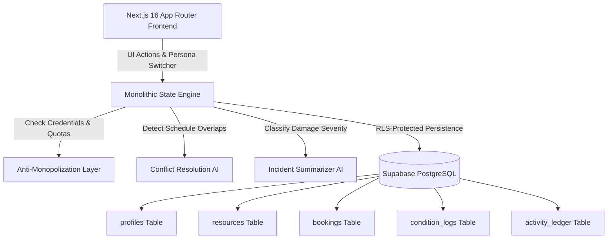

# LatentLab (by Team Analytical Eye)
## *Unlocking Underused Research Equipment, Scientific Labs & Spaces*
**Problem Statement:** Unlock Underused Equipment and Spaces  
**Team Name:** Analytical Eye  
**Sole Member & Lead:** Pankhuri Govila  
**Project Track:** Cross-Departmental University & Research Lab Sharing Network  

---

## 1. Executive Summary & Problem Framing

### One-Line Description
**LatentLab** is an institutional resource-sharing network engineered to unlock billions in dormant laboratory hardware, makerspaces, cleanrooms, and high-performance computing clusters through verifiable safety credentials, digital chain of custody, and an anti-monopolization credit economy.

### Why This Problem Matters (Evidence & Research Grounding)
Colleges, research institutions, and community makerspaces own millions of dollars in advanced equipment that sits idle for substantial periods:
- **Severe Temporal Underutilization:** Specialized instruments (e.g., Next-Gen Sequencers, high-power CO2 laser cutters, 8x GPU nodes, cinema camera kits) typically operate at only **25%–35% utilization** outside core departmental hours.
- **Access Inequity:** PhD scholars, undergraduate researchers, and cross-departmental innovators frequently cannot afford the capital expense or commercial rental rates for high-end instruments.
- **The Trust & Safety Void:** Ordinary booking systems (like Google Calendar, Outlook, or Calendly) only manage calendar time slots. They do not address:
  - **Safety & Competency Verification:** Requiring proof of BSL-2 biosafety certifications, laser safety clearance, or cleanroom gowning.
  - **Accountability & Chain of Custody:** Verifying equipment condition before an electronic lock is released versus after return to trace damages.
  - **Monopolization & Hoarding:** Preventing single research groups from blocking shared assets indefinitely.

---

## 2. Quick Start & Evaluation Guide

The full interactive prototype is pre-built, tested, and running live locally at:  
👉 **`http://localhost:3000`**

### Running Locally from Source
```bash
# Navigate to the application directory
cd analytical-eye-lab

# Install dependencies
npm install

# Start development server
npm run dev
```

### 3-Minute Judge Evaluation Flow
1. **Persona Switcher:** Use the top-bar dropdown to switch between:
   - **Pankhuri Govila (You):** Researcher / User (100 credits, training badges: Laser Cutter, BSL-2, GPU Slurm).
   - **Dr. Aris Thorne (PI):** Biotech Lab Owner.
   - **Elena Rostova (Lab Mgr):** Makerspace Manager.
   - **Office of Research Integrity:** Administrator.
2. **Tab 1 — Discovery & Match:** View real-time qualification checking (**"Verified Eligible"** vs **"Missing Badge"**). Select a resource and click **"Run Conflict Resolution AI"** to see dynamic schedule de-confliction.
3. **Tab 2 — My Bookings & Check-In:** Complete **Milestone 7 (Digital Check-In)** with a 1-5★ rating, notes, and PPE acknowledgment to unlock hardware. Then complete **Milestone 8 (Digital Return)** to observe late-penalty calculation and resource re-locking.
4. **Tab 3 — Owner Portal & Listing:** List a new resource with custom badge requirements (**Milestone 1**) or approve/reject pending booking requests (**Milestone 5**).
5. **Tab 4 — Dispute & Incident Hub:** Enter damage descriptions and run the **Incident Summarizer AI** for NLP severity classification (Low/Med/High) and triage recommendations (**Milestone 9**).
6. **Tab 5 — Auditable Ledger Timeline:** Inspect the immutable event stream recording timestamps, actors, and JSON metadata payloads (**Milestone 10**).

---

## 3. The 10-Milestone End-to-End Lifecycle Workflow

LatentLab exposes an unbroken, 10-step sequential workflow that judges can evaluate without manual simulation:

| Step | Milestone | Lifecycle Phase & Implementation |
|---|---|---|
| **1** | **Owner Listing Dashboard** | Faculty owners and facility supervisors publish equipment, configure credit hourly rates, define availability slots, and mandate training badges (e.g., *"Laser Cutter Safety Cert"*, *"BSL-2 Biosafety"*). |
| **2** | **Discovery & Match Interface** | Researchers search by department, equipment category, or location. Real-time middleware checks user badges against resource requirements (**"✓ Verified Eligible"** vs **"⚠️ Missing Badge"**). |
| **3** | **Booking Engine** | Validates user balance against credit costs and verifies compliance with the 3-booking anti-monopolization quota. |
| **4** | **Auto-Verification Layer** | Evaluates prerequisites. If conflicting requests occur, offers AI-suggested alternative time slots or pushes the user into a transparent queue (*"Position #X in line"*). |
| **5** | **Owner Review Portal** | Equipment custodians approve or reject requests with transparent, logged reason fields. Rejections immediately issue an automatic credit refund. |
| **6** | **State Transition Banner** | Persistent real-time visual alerts notify users of approvals, queue promotions, active unlock states, or cancellations. |
| **7** | **Digital Check-In** | User logs baseline condition rating (1-5★), physical inspection notes, photo proof, and acknowledges mandatory PPE compliance before the resource transitions to unlocked/active. |
| **8** | **Digital Return / Check-Out** | Final inspection rating and sanitization notes recorded. Automated formula calculates overdue penalties (5 credits / 15 mins) and restores availability to campus. |
| **9** | **Dispute & Incident Hub** | Direct reporting of hardware defects, optical scratches, or delays. Vercel AI SDK processes descriptions into severity classifications with maintenance triage. |
| **10** | **Auditable Ledger Timeline** | Immutable, chronological visual ledger logging actor, timestamp, action type, and JSON metadata payloads for institutional governance. |

---

## 4. Fairness, Anti-Monopolization & Economic Model

To avoid tragedy-of-the-commons resource exhaustion, LatentLab implements a three-tier fairness model:
1. **100 Monthly Sponsored Credits:** Every verified institutional researcher receives 100 non-accumulating monthly credits. High-demand equipment incurs higher credit rates, fostering cost awareness without requiring out-of-pocket payment.
2. **Anti-Monopolization Active Booking Cap (Max 3):** Users are restricted to a maximum of 3 concurrent active bookings (`pending`, `approved`, `checked_in`, `waitlisted`). Hoarding multiple assets blocks further reservations until active sessions conclude.
3. **Explainable Waitlist & Transparent Queue:** When demand exceeds capacity, users enter a deterministic queue displaying *"Position #X in line due to high demand"*, automatically promoting when earlier reservations conclude or cancel.

---

## 5. Lightweight AI Integrations (Vercel AI SDK)

1. **Conflict Resolution AI (`analyzeBookingConflict`)**
   - Detects micro-overlaps across scheduled reservation vectors.
   - Calculates duration and synthesizes intelligent alternative windows:
     - **Earliest Available:** 30 minutes after current reservation concludes with automated maintenance/cooling buffer.
     - **Next-Day Slot:** Identical preferred time block on the next available calendar date.
2. **Incident Summarizer AI (`summarizeIncidentReport`)**
   - Natural language processing parses operator descriptions of damage, smoke, or errors.
   - Classifies incidents into **Low / Medium / High Severity**.
   - Generates actionable maintenance triage directives (e.g., immediate lockout, technician dispatch, estimated downtime hours).

---

## 6. System Architecture & Tech Stack



- **Frontend & App Router:** Next.js 16 (React 19, Turbopack, TypeScript)
- **Styling:** Tailwind CSS, Lucide React, Glassmorphism design tokens
- **Database Engine:** PostgreSQL with Row Level Security (RLS) on Supabase
- **AI Tooling:** Vercel AI SDK pattern with resilient local fallback for zero-downtime offline evaluation
- **Architecture Philosophy:** Monolithic solo architecture — all interactive workflows, state mutations, and validation rules reside in tightly coupled modules, eliminating manual assembly errors.

---

## 7. PostgreSQL Database Schema Overview (`schema.sql`)

The repository includes a direct, copy-pasteable [schema.sql](schema.sql) file configuring:
- **`profiles`:** User metadata, role (`user`, `owner`, `manager`, `admin`), department, verified status, training badge arrays, and credits balance.
- **`resources`:** Equipment catalog, category, location, credit rates, availability slots, and eligibility criteria rules.
- **`bookings`:** Reservation state machine (`pending`, `approved`, `rejected`, `waitlisted`, `checked_in`, `returned`, `disputed`), timestamps, credit deductions, and queue position.
- **`condition_logs`:** Digital handshake entries (`check_in`, `check_out`), star ratings (1–5), notes, and photo proof URLs.
- **`activity_ledger`:** Immutable audit log tracking actors, timestamps, action codes, and JSON metadata payloads.
- **Row Level Security (RLS):** Granular policies protecting user data, restricting owner modification to owned assets, and providing campus administrators with complete audit oversight.

---

## 8. Team & Contribution Details

- **Team Name:** Analytical Eye
- **Sole Member & Developer:** Pankhuri Govila
- **Contribution (100%):** Conceived problem framing, institutional credit model, PostgreSQL RLS schema, Next.js frontend, AI conflict and incident triage modules, testing, and documentation.
- **Disclosure:** Built during the official 48-hour hackathon window using Next.js, Tailwind CSS, Lucide React, and Supabase client libraries. Seed data represents fictionalized institutional resources for demonstration purposes.
